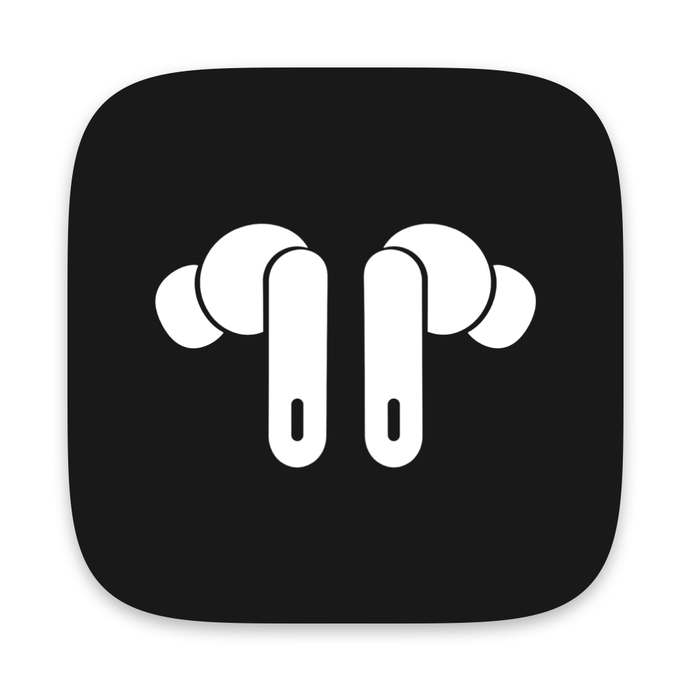
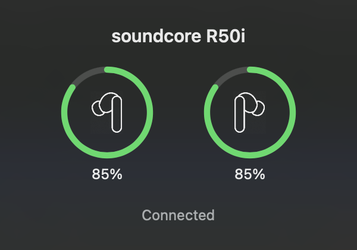
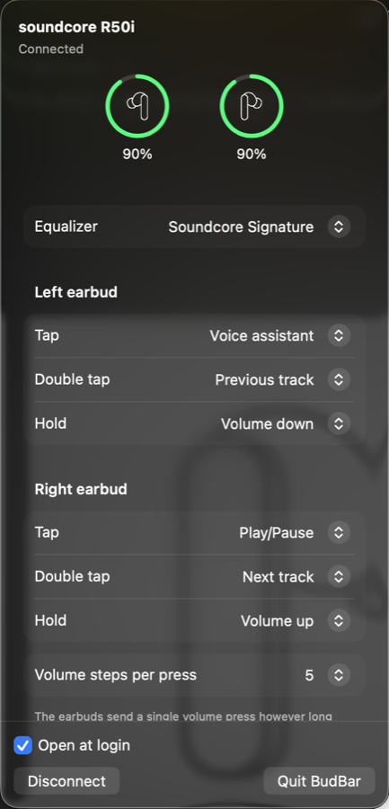

<p align="center"></p>

# BudBar

A small macOS menu bar app for **soundcore R50i** earbuds (model A3949, also sold as P20i and P25i). It shows each earbud's battery, pops up an AirPods-style card when they connect, and changes their settings without the phone app.

<p align="center">
  
  
</p>

## Features

- Battery in the menu bar, plus a card with left and right battery rings when the earbuds connect
- 22 EQ presets, touch controls (tap, double tap, hold on each earbud), gaming mode, touch tone
- **Volume steps per press:** the earbuds send one volume press however long you hold, so BudBar can turn each press into several quick steps
- Connect to this Mac or disconnect, from the menu
- Open at login

## Limitations

- Only the R50i (A3949) for now. Other Soundcore models use the same protocol, but each needs its own definition (see OpenSCQ30's device list).
- The earbuds report battery as 0–5 over their own protocol, and as 0–9 over HFP, which is what macOS shows in 10% steps. While both earbuds are on the same level, BudBar shows the macOS reading and estimates the 1% steps in between: a reading drops right as the battery crosses a boundary, and the battery then keeps draining at the rate measured between the last two drops. Until it has seen a drop, it shows the same number as macOS. The macOS reading comes from a private IOBluetooth property, `batteryPercentSingle`; BudBar checks that it exists and otherwise uses the earbuds' own report.
- The earbuds keep separate touch actions for wearing one earbud or both, and only change the set in use. To change what one earbud does on its own, put the other in the case first.
- The R50i's JieLi chip also answers JieLi's RCSP protocol on its `JL_SPP` channel (after JieLi's authentication handshake), but its battery field there stays at 100 on this firmware, so BudBar doesn't use it.
- The R50i can't connect to two devices at once. That's a hardware and firmware limit.
- Third-party earbuds can't appear in System Settings like AirPods do, or use Apple features like automatic switching. Those are private to Apple's own devices.

## Build

Needs macOS 14 or later and Xcode (Swift 6).

```sh
./scripts/bundle.sh      # builds build/BudBar.app
open build/BudBar.app
swift test               # protocol tests
```

Run `./scripts/make-signing-identity.sh` once first. It creates a local signing identity in your login keychain, so macOS keeps BudBar's permissions across rebuilds. Without it the app is ad-hoc signed, and macOS asks again after every rebuild.

## Permissions

- **Bluetooth:** to talk to the earbuds.
- **Input Monitoring:** only when "Volume steps per press" is above 1, to see the earbuds' volume presses.

## Credits

The Soundcore protocol (packet format, EQ presets, DRC math, the R50i state layout) is ported from [OpenSCQ30](https://github.com/Oppzippy/OpenSCQ30) by Oppzippy, under GPL-3.0. The app icon and the earbud icons were drawn with OpenAI's image model through Codex.

Not affiliated with Anker. soundcore is a trademark of Anker Innovations.

## License

GPL-3.0. See [LICENSE](LICENSE).
